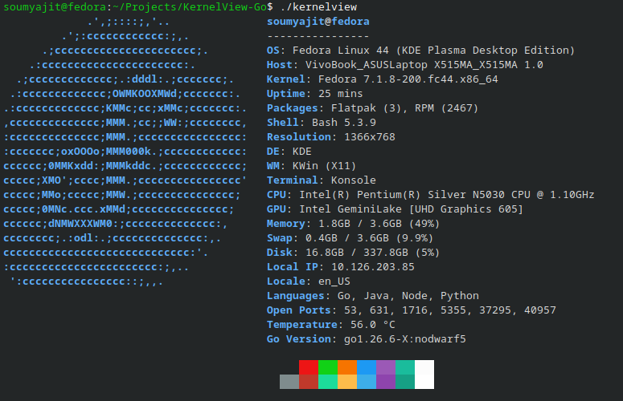
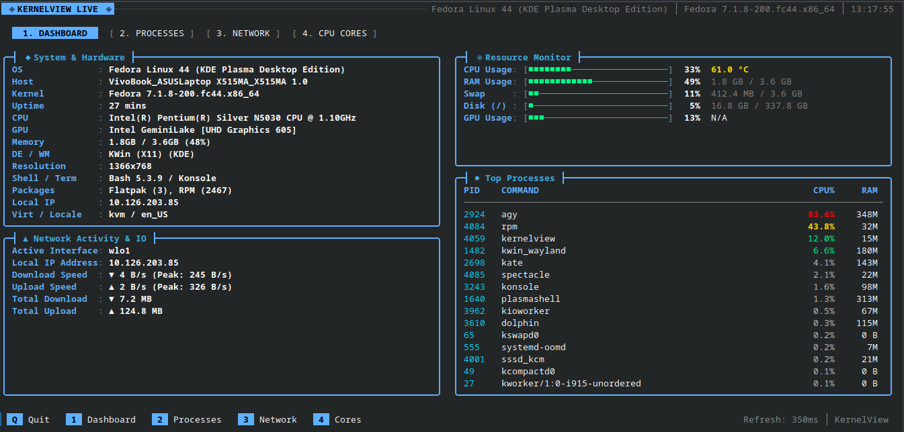
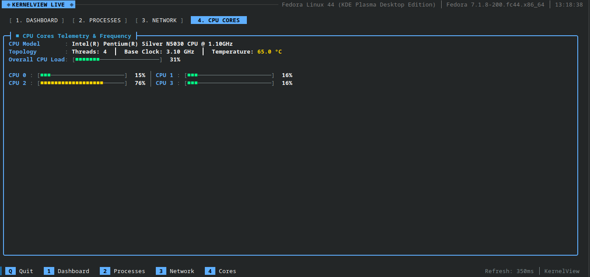

# 🚀 KernelView Go

<p align="center">
  
  
  
  
  <a href="https://github.com/codedbysoumyajit/KernelView-Go/releases">
    
  </a>
</p>

**KernelView Go** is an ultra-fast, lightweight system information fetcher and real-time terminal telemetry dashboard written in pure Go. Engineered with zero external dependencies and direct kernel/sysfs parsing, it delivers sub-millisecond hardware queries, distro-branded ASCII art, deep kernel and security diagnostics, and an interactive multi-tab live TUI dashboard.

---

### ⚡ Quick Start

```bash
# Linux, macOS & BSD (One-line install & upgrade)
curl -fsSL https://raw.githubusercontent.com/codedbysoumyajit/KernelView-Go/main/install.sh | sh

# Windows (PowerShell)
irm https://raw.githubusercontent.com/codedbysoumyajit/KernelView-Go/main/install.ps1 | iex
```

---

## 📸 Screenshots

<p align="center">
  <b>System Fetch with Distro-Branded ASCII Art & Hardware Telemetry</b><br>
  
</p>

<p align="center">
  <b>Interactive Real-Time TUI Dashboard (Multi-Tab Telemetry)</b><br>
  
</p>

<p align="center">
  <b>Multi-Core CPU Frequency & Load Distribution Grid</b><br>
  
</p>

---

## ✨ Features

### 🐧 Deep Kernel & Security Diagnostics (`-k`, `--kernel`)
* **Build & Release Metadata**: Kernel release, target architecture, compiler toolchain (`gcc`/`clang`), and preemption model (`PREEMPT_DYNAMIC`, `PREEMPT_RT`, `SMP`).
* **Sanitized Boot Command Line**: Strips noisy bootloader parameters (`BOOT_IMAGE`, lengthy disk UUIDs) to highlight critical runtime flags.
* **Kernel Modules & Footprint**: Loaded vs on-disk module counts, total module memory footprint, and top dependent kernel modules.
* **Security & Isolation State**: Instant detection of **Secure Boot** (UEFI / MOK), **Kernel Lockdown** mode (`none`, `integrity`, `confidentiality`), and active **LSMs** (`SELinux`, `AppArmor`, `Landlock`, `BPF`, `TOMOYO`, `Smack`).
* **Hardening & Hardware Features**: Real-time status for **KASLR**, **eBPF JIT** compiler hardening, CPU frequency scaling governor, clocksource, and memory page size.
* **CPU Vulnerabilities**: Live mitigation status parsed directly from `/sys/devices/system/cpu/vulnerabilities/*` (mitigations, not affected, vulnerable).
* **Kernel Update & Reboot Detection**: Compares running release against `/boot` kernel images to flag pending reboot requirements.

### 🖥️ Interactive Real-Time TUI Dashboard (`-l`, `--live`)
* **100% Flicker-Free Rendering**: Terminal synchronized update buffering (`\033[?2026h`) completely prevents screen tearing and flashing during view transitions and resizing.
* **Zero-Allocation Layout Engine**: Single-pass UTF-8 text measurement with 0 heap allocations per frame (~60x faster text layout).
* **Six Dedicated Telemetry Tabs**:
  * `[1] Dashboard`: System overview, CPU & RAM gauges, active network rates, and top processes.
  * `[2] Processes`: Live process monitor sorted dynamically by CPU and memory consumption.
  * `[3] Network`: Real-time transfer rates (upload/download), active interfaces, state, and lifetime traffic.
  * `[4] CPU Cores`: Dedicated multi-column per-core frequency and load grid with temperature meters.
  * `[5] Disk / IO`: Mounted partition utilization, per-disk read/write speeds, and IOPS tracking.
  * `[6] Logs`: Live system log stream across Linux (`journalctl` / `syslog`), macOS (`log show` / `system.log`), Windows (`Event Log` / `wevtutil`), and BSD (`/var/log/messages`). Features color-coded severity badges (`[INFO]`, `[WARN]`, `[ERR ]`, `[DBUG]`), interactive severity filtering, and scrollable log history.
* **Fluid Keyboard Controls**:
  * `Tab` / `Shift+Tab`: Cycle through tabs forward and backward.
  * `←` / `→` Arrows or `h` / `l` Vim Keys: Smooth directional tab switching.
  * `1`–`6` / `d`, `p`, `n`, `c`, `i`, `s` / `o`: Direct tab hotkeys.
  * `f` / `F`: Cycle log severity filter (`ALL` → `ERR` → `WARN+ERR` → `INFO` → `ALL`).
  * `↑` / `↓` Arrows or `k` / `j` Vim Keys: Scroll through log history (`g` / `G` for top/bottom).
  * `q` / `Q` / `Esc` / `Ctrl+C`: Clean terminal restoration and exit.
* **Adaptive Fast Mode**: Combine `-l` with `-f` (`kernelview -l -f`) for an ultra-responsive 200ms telemetry cycle.

### ⚡ Sub-Millisecond Architecture
* **Direct DRM & Udev GPU Probing**: Zero-subprocess sysfs connector and `/run/udev/data/+pci:*` RAM reads replace slow `lspci` forks (<0.5ms).
* **Embedded SQLite RPM Reader**: Internal pure Go B-Tree engine queries RPM package databases in `<0.3ms` without child processes.
* **Kernel Worker Filtering**: Pre-filters kernel threads in `/proc` before allocation, cutting iteration overhead by ~45%.
* **Parallelized Probing**: Asynchronous graphics APIs (OpenGL, Vulkan, OpenCL, CUDA), multi-source public IP resolution, and Wi-Fi telemetry.
* **Standard Compliance**: Fully adheres to the [`NO_COLOR`](https://no-color.org/) standard (`--no-color` flag and `NO_COLOR` environment variable).

### 🎨 Distro & Hardware Branding
* **110+ Distro Logos**: Authentic ASCII art and palette themes aligned with Fastfetch for Linux (Ubuntu, Fedora, Arch, Debian, openSUSE, Alpine, Amazon Linux, KDE Linux, Proxmox, Armbian, DietPi, Slackware, Raspbian, Artix, Asahi, Haiku, Guix, Devuan, Mageia, etc.), macOS, Windows, and BSDs (FreeBSD, OpenBSD, NetBSD, DragonFly, GhostBSD, NomadBSD, MidnightBSD).
* **GPU Vendor Art**: Dedicated `cpufetch`-style ASCII art for **Intel**, **AMD Radeon**, **NVIDIA**, **Apple Silicon**, and **ARM Mali** in `-g` mode.
* **Dynamic Palette Theming**: Auto-detects OS and hardware vendor to dynamically theme keys, labels, borders, and meters.

---

## ⌨️ CLI Usage & Flags

```
USAGE:
  kernelview [flags]

DISPLAY MODES:
  -k, --kernel       Detailed kernel parameters, modules, security & mitigations
  -g, --gpu          Detailed static GPU & graphics API report (OpenGL, Vulkan, OpenCL, CUDA)
  -n, --network      Detailed static network interfaces, Wi-Fi telemetry & IP stats
  -p, --process      Static snapshot of running processes sorted by resource usage
  -l, --live         Start real-time interactive multi-tab TUI dashboard
  [default]          Standard system fetch with distro ASCII art & specs

CONFIGURATION OPTIONS:
  -f, --fast         Fast mode: sub-10ms execution, skips heavy scans
  --json             Output gathered telemetry as structured JSON
  --no-color         Disable all ANSI styling (also respects NO_COLOR env)

INFO FLAGS:
  -v, --version      Print version and build information
  -h, --help         Print help menu
```

### Common Commands
```bash
# Standard system fetch
kernelview

# Sub-10ms ultra-fast fetch
kernelview -f

# Deep kernel & security report
kernelview -k

# GPU models, VRAM, clock rates & graphics APIs
kernelview -g

# Network interfaces & public IP details
kernelview -n

# Real-time interactive live dashboard
kernelview -l

# Live dashboard in fast mode (200ms refresh)
kernelview -l -f

# Export telemetry to structured JSON
kernelview --json
kernelview -k --json
```

---

## 🏎️ Performance Benchmarks

Measured real wall-clock latency on Linux hardware:

| Mode / Command | Typical Latency | Key Data Gathered |
| :--- | :--- | :--- |
| **`kernelview -f` (Fast Mode)** | **`~7 – 15 ms`** | OS, Kernel, Uptime, CPU, GPU, Memory, Disk, IP, Resolution, Shell |
| **`kernelview -k` (Kernel Mode)** | **`~7 – 10 ms`** | Version, Build, Modules, Dependencies, Lockdown, LSMs, KASLR, Vulnerabilities |
| **`kernelview` (Default Mode)** | **`~30 – 140 ms`** | Full fetch including packages (RPM/APT/Flatpak/Snap), ports, languages, temp |
| **`kernelview -p` (Process Mode)** | **`~112 ms`** | Ranked process table with PID, CPU %, Memory %, and RSS |
| **`kernelview -g` (GPU Mode)** | **`~150 ms`** | Hardware models, VRAM, Clocks, Displays, OpenGL, Vulkan, OpenCL, CUDA |
| **`kernelview -l` (Live TUI)** | **`200 / 350 ms`** | Real-time multi-tab telemetry running at `<1.0%` CPU utilization |

---

## 🗂️ Platform Support

| Operating System | Architectures | Status |
| :--- | :--- | :--- |
| **Linux** (Fedora, Arch, Ubuntu, Debian, openSUSE, Alpine, RHEL, Mint, etc.) | `amd64`, `arm64`, `arm`, `riscv64`, `386` | Native (Full support) |
| **macOS** (Sonoma, Ventura, Monterey, etc.) | Apple Silicon (`arm64`), Intel (`amd64`) | Native (Full support) |
| **Windows** (Windows 11, 10, Server) | `amd64`, `arm64`, `386` | Native (Registry & Console) |
| **BSD** (FreeBSD, OpenBSD, NetBSD, DragonFly) | `amd64`, `arm64` | Native (sysctl & kvm) |
| **Android / Termux** | `arm64`, `arm`, `amd64` | Native (`$PREFIX/bin`) |

---

## 💻 Installation

### ⚡ One-Line Install Script (Linux, macOS, BSD, Android/Termux)
The universal installer automatically detects your OS, architecture, and existing installation, offering seamless upgrades:

```bash
# Standard installation or update:
curl -fsSL https://raw.githubusercontent.com/codedbysoumyajit/KernelView-Go/main/install.sh | sh

# Non-interactive / CI (auto-confirm):
curl -fsSL https://raw.githubusercontent.com/codedbysoumyajit/KernelView-Go/main/install.sh | sh -s -- -y

# Install latest Beta / Nightly channel directly:
curl -fsSL https://raw.githubusercontent.com/codedbysoumyajit/KernelView-Go/main/install.sh | sh -s -- --beta

# User-local install (~/.local/bin) without sudo:
curl -fsSL https://raw.githubusercontent.com/codedbysoumyajit/KernelView-Go/main/install.sh | sh -s -- --user
```

### Windows (PowerShell)
Supports Windows PowerShell 5.1 and PowerShell Core 7+ without requiring Administrator rights:

```powershell
# Standard installation or update:
irm https://raw.githubusercontent.com/codedbysoumyajit/KernelView-Go/main/install.ps1 | iex

# Install latest Beta / Nightly channel directly:
& ([scriptblock]::Create((irm https://raw.githubusercontent.com/codedbysoumyajit/KernelView-Go/main/install.ps1))) -Beta

# Non-interactive / CI:
& ([scriptblock]::Create((irm https://raw.githubusercontent.com/codedbysoumyajit/KernelView-Go/main/install.ps1))) -Yes
```

---

### 📦 Package Managers

#### Ubuntu & Linux Mint (PPA)
```bash
sudo add-apt-repository ppa:codedbysoumyajit/kernelview
sudo apt update
sudo apt install kernelview
```

#### Fedora Linux (COPR)
```bash
sudo dnf copr enable codedbysoumyajit/kernelview
sudo dnf install kernelview
```

#### Go Install
```bash
go install github.com/codedbysoumyajit/KernelView-Go@latest
```

---

### 📦 Pre-Built Binaries
Download pre-compiled binaries for your architecture directly from the [GitHub Releases](https://github.com/codedbysoumyajit/KernelView-Go/releases) page:
* **Linux**: `amd64`, `arm64`, `arm`, `riscv64`, `386` (glibc & musl/Alpine)
* **macOS**: `arm64` (Apple Silicon M1/M2/M3/M4), `amd64` (Intel Mac)
* **Windows**: `amd64`, `arm64`, `386` (.zip / .exe)
* **BSD**: `freebsd_amd64`, `openbsd_amd64`, `netbsd_amd64`

---

### 🛠️ Building From Source

```bash
# Clone repository
git clone https://github.com/codedbysoumyajit/KernelView-Go.git
cd KernelView-Go

# Build optimized binary
go build -ldflags="-s -w -X main.version=v1.4.0-nightly" -o kernelview .

# Move to system PATH (Linux / macOS / BSD)
sudo mv kernelview /usr/local/bin/
```

---

## 📄 License

This project is licensed under the **MIT License**. See the [LICENSE](file:///home/soumyajit/Projects/KernelView-Go/LICENSE) file for details.
