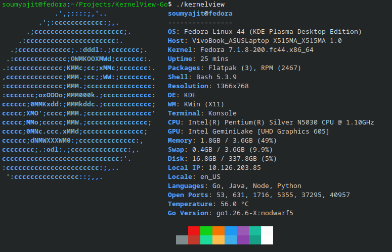
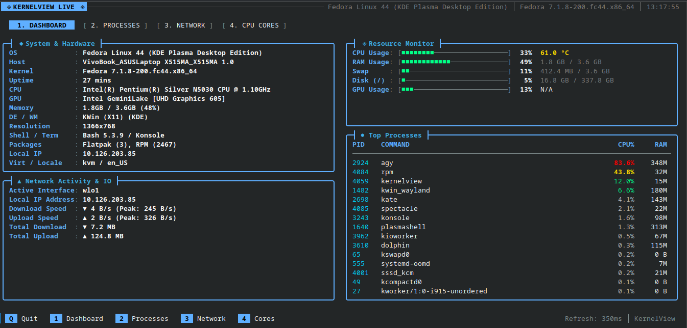
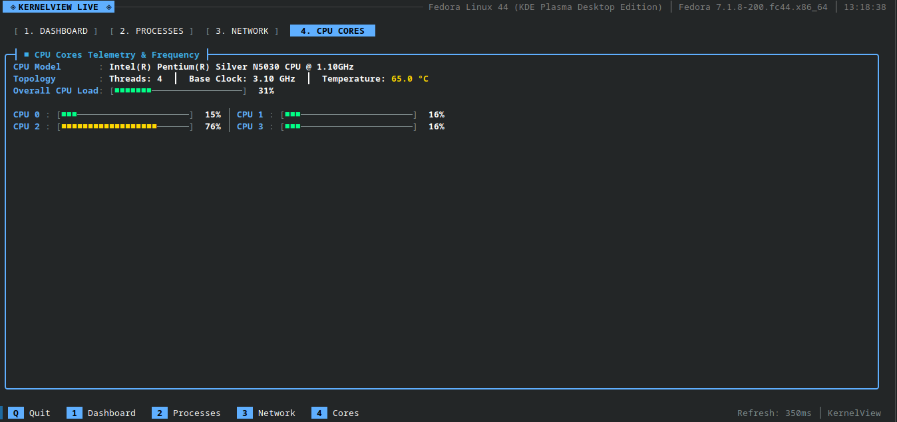

# 🚀 KernelView Go

<p align="center">
  <a href="https://kernelview.codedbysoumyajit.dev">
    
  </a>
  
  
  
  <a href="https://github.com/codedbysoumyajit/KernelView-Go/releases">
    
  </a>
</p>

**KernelView Go** is an ultra-fast, lightweight system information fetcher and real-time terminal telemetry dashboard written in pure Go. Built with zero runtime dependencies and direct kernel/sysfs parsing, it delivers sub-millisecond hardware queries, distro-branded ASCII art, deep kernel and security diagnostics, and an interactive multi-tab live TUI dashboard.

🌐 **Website & Docs**: [https://kernelview.codedbysoumyajit.dev](https://kernelview.codedbysoumyajit.dev)

---

## 📸 Screenshots

<p align="center">
  <b>System Fetch with Distro-Branded ASCII Art & Hardware Telemetry</b><br>
  
</p>

<p align="center">
  <b>Interactive Real-Time TUI Dashboard (Multi-Tab Telemetry)</b><br>
  
</p>

<p align="center">
  <b>Multi-Core CPU Frequency & Load Distribution Grid</b><br>
  
</p>

---

## ✨ Features

### 🎨 Distro & GPU Hardware Branding
* **40+ Distro Logos**: Authentic ASCII art matching Fastfetch for Linux distributions, macOS, Windows, and BSD.
* **GPU Vendor Art**: Dedicated `cpufetch`-style ASCII art for **Intel**, **AMD Radeon**, **Nvidia**, **Apple Silicon**, and **ARM Mali** in `-g` mode.
* **Dynamic Palette Theming**: Auto-detects OS/hardware vendor and dynamically themes keys, labels, borders, and meters to match.
* **ANSI Color Grid**: Classic 16-color ANSI blocks (`███`) for terminal color verification.

### 🐧 Deep Kernel & Security Inspection (`-k`, `--kernel`)
* **Build & Release Metadata**: Kernel version, architecture, compiler toolchain (`gcc`/`clang`), and preemption model (`PREEMPT_DYNAMIC`, `PREEMPT_RT`, `SMP`).
* **Cleaned Command Line**: Boot arguments parsed with bootloader UUIDs and `BOOT_IMAGE` noise filtered out.
* **Module & Dependency Telemetry**: Loaded vs installed kernel modules, total memory footprint, and top module dependencies.
* **Security & Hardening**: Real-time status for **Secure Boot**, **Kernel Lockdown** mode (`none`, `integrity`, `confidentiality`), active **LSMs** (`SELinux`, `AppArmor`, `Landlock`, etc.), **KASLR**, and **eBPF JIT** compiler hardening.
* **CPU Vulnerabilities**: Live mitigation summary parsed from `/sys/devices/system/cpu/vulnerabilities/*`.
* **Kernel Updates**: Compares running release against `/boot` images to report pending reboot requirements.

### 🖥️ Interactive Real-Time TUI Dashboard (`-l`, `--live`)
* **Flicker-Free Rendering**: Synchronized update buffering (`\033[?2026h`) prevents screen tearing and flashing during view transitions or terminal resizing.
* **Zero-Allocation Layout Engine**: Single-pass UTF-8 text measurement with 0 heap allocations per frame.
* **Fluid Keyboard Controls**:
  * `Tab` / `Shift+Tab`: Cycle through tabs forward and backward.
  * `←` / `→` Arrows or `h` / `l` Vim Keys: Smooth directional tab switching.
  * `1`–`5` / `d`, `p`, `n`, `c`, `i`: Direct tab hotkeys.
  * `q` / `Q` / `Esc` / `Ctrl+C`: Clean exit and terminal restoration.
* **Five Dedicated Views**:
  * `[1] Dashboard`: System summary, CPU/RAM usage meters, active network throughput, and top processes.
  * `[2] Processes`: Live process monitor sorted dynamically by CPU and memory consumption.
  * `[3] Network`: Bandwidth rates (upload/download), active interfaces, state, and lifetime totals.
  * `[4] CPU Cores`: Dedicated multi-column per-core frequency and load grid with temperature meters.
  * `[5] Disk / IO`: Mounted partition utilization, per-disk read/write speeds, and IOPS tracking.
* **Adaptive Fast Mode**: Combine `-l` with `-f` (`kernelview -l -f`) for an ultra-responsive 200ms telemetry cycle.

### ⚡ Sub-Millisecond Architecture
* **Zero-Subprocess Core**: Direct reads from `/sys`, `/proc`, and `udev` in RAM replace slow `lspci` and external shell calls.
* **Embedded SQLite RPM Reader**: Internal pure Go B-Tree engine queries RPM databases in `<0.3ms` without invoking `rpm -qa`.
* **Standard Compliance**: Fully honors the [`NO_COLOR`](https://no-color.org/) standard and `--no-color` flag.

---

## ⌨️ CLI Usage & Flags

```
USAGE:
  kernelview [flags]

DISPLAY MODES:
  -k, --kernel       Display detailed kernel parameters, modules, security & mitigations
  -g, --gpu          Display detailed static GPU & graphics API report
  -n, --network      Display detailed static network interfaces & stats
  -p, --process      Display static list of running processes
  -l, --live         Start real-time TUI dashboard (interactive, multi-tab)
  [default]          Display standard system fetch (distro ASCII logo & specs)

CONFIGURATION OPTIONS:
  -f, --fast         Run system info in fast mode (sub-10ms execution)
  --json             Output gathered information as structured JSON
  --no-color         Disable all ANSI color formatting (also respects NO_COLOR env)

INFO FLAGS:
  -v, --version      Print version and build information
  -h, --help         Print help menu
```

### Common Commands
```bash
# Standard system fetch
kernelview

# Ultra-fast mode (<10ms)
kernelview -f

# Kernel parameters, security & mitigation report
kernelview -k

# GPU models, VRAM, clock rates & graphics APIs (OpenGL, Vulkan, OpenCL, CUDA)
kernelview -g

# Network interfaces, Wi-Fi telemetry & IP details
kernelview -n

# Static snapshot of running processes
kernelview -p

# Launch interactive real-time live dashboard
kernelview -l

# Export telemetry to JSON
kernelview --json
kernelview -k --json
```

---

## 🏎️ Performance Benchmarks

Measured real wall-clock latency on standard Linux hardware:

| Mode / Command | Typical Latency | Key Data Gathered |
| :--- | :--- | :--- |
| **`kernelview -f` (Fast Mode)** | **`~7 – 15 ms`** | OS, Kernel, Uptime, CPU, GPU, Memory, Disk, IP, Resolution, Shell |
| **`kernelview -k` (Kernel Mode)** | **`~7 – 10 ms`** | Version, Build, Modules, Dependencies, Lockdown, LSMs, KASLR, Vulnerabilities |
| **`kernelview` (Default Mode)** | **`~30 – 140 ms`** | Full fetch including packages (RPM/APT/Flatpak/Snap), ports, languages, temp |
| **`kernelview -p` (Process Mode)** | **`~112 ms`** | Ranked process table with PID, CPU %, Memory %, and RSS |
| **`kernelview -g` (GPU Mode)** | **`~150 ms`** | Hardware models, VRAM, Clocks, Displays, OpenGL, Vulkan, OpenCL, CUDA |
| **`kernelview -l` (Live TUI)** | **`200 / 350 ms`** | Real-time multi-tab telemetry running at `<1.0%` CPU utilization |

---

## 🗂️ Platform Support

| Operating System | Architectures | Status |
| :--- | :--- | :--- |
| **Linux** (Fedora, Arch, Ubuntu, Debian, openSUSE, Alpine, RHEL, Mint, etc.) | `amd64`, `arm64`, `arm`, `riscv64` | Native (Full support) |
| **macOS** (Sonoma, Ventura, Monterey, etc.) | Apple Silicon (`arm64`), Intel (`amd64`) | Native (Full support) |
| **Windows** (Windows 11, 10, Server) | `amd64`, `arm64` | Native (Registry & Console) |
| **BSD** (FreeBSD, OpenBSD, NetBSD) | `amd64` | Native (sysctl & kvm) |

---

## 💻 Installation

### ⚡ One-Line Install Script (Linux, macOS, BSD)
```bash
curl -fsSL https://raw.githubusercontent.com/codedbysoumyajit/KernelView-Go/main/install.sh | sh
```

### Windows (PowerShell)
```powershell
irm https://raw.githubusercontent.com/codedbysoumyajit/KernelView-Go/main/install.ps1 | iex
```

---

### 📦 Package Managers

#### Ubuntu & Linux Mint (PPA)
```bash
sudo add-apt-repository ppa:codedbysoumyajit/kernelview
sudo apt update
sudo apt install kernelview
```

#### Fedora Linux (COPR)
```bash
sudo dnf copr enable codedbysoumyajit/kernelview
sudo dnf install kernelview
```

#### Arch Linux (AUR)
```bash
yay -S kernelview-bin
# or
paru -S kernelview-bin
```

#### Go Install
```bash
go install github.com/codedbysoumyajit/KernelView-Go@latest
```

---

### 📦 Pre-Built Binaries
Download pre-compiled binaries for your architecture from the [GitHub Releases](https://github.com/codedbysoumyajit/KernelView-Go/releases) page:
* `Linux`: `amd64`, `arm64`, `armv6`, `armv7`, `riscv64`
* `macOS`: `arm64` (Apple Silicon M1/M2/M3/M4), `amd64` (Intel Mac)
* `Windows`: `amd64`, `arm64` (.zip / .exe)
* `BSD`: `freebsd_amd64`, `openbsd_amd64`, `netbsd_amd64`

---

### 🛠️ Building From Source

```bash
# Clone the repository
git clone https://github.com/codedbysoumyajit/KernelView-Go.git
cd KernelView-Go

# Build optimized binary
go build -ldflags="-s -w" -o kernelview .

# Move to system PATH (Linux / macOS / BSD)
sudo mv kernelview /usr/local/bin/
```

---

## 📄 License

This project is licensed under the **MIT License**. See the [LICENSE](file:///home/soumyajit/Projects/KernelView-Go/LICENSE) file for details.
